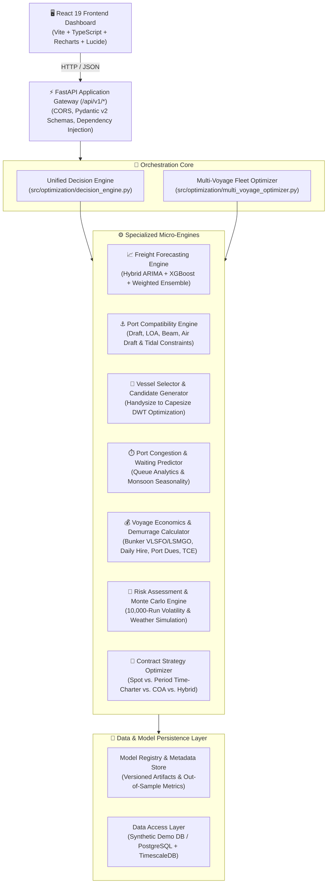

# 🚢 Dock Insight (DockInsights)
### *Advanced Bulk Vessel Chartering & Freight Intelligence Platform*

[](https://www.sih.gov.in/)
[](https://fastapi.tiangolo.com/)
[](https://www.python.org/)
[](https://react.dev/)
[](https://www.typescriptlang.org/)
[](https://vitejs.dev/)
[](https://xgboost.readthedocs.io/)
[](https://www.docker.com/)
[](LICENSE)

---

## 📌 Executive Overview

**Dock Insight** (DockInsights) is an enterprise-grade maritime freight intelligence and vessel chartering decision-support platform. Engineered specifically for complex dry-bulk logistics corridors across the **Indian East Coast** (Dhamra, Paradip, Haldia, Visakhapatnam, Krishnapatnam, Ennore, Chennai), it eliminates fragmented, heuristic-driven chartering decisions.

The platform continuously processes real-time and historical freight data, port navigational constraints, queuing congestion patterns, and macroeconomic indices. By synthesizing these multidimensional parameters through six decoupled micro-engines, Dock Insight recommends the mathematically optimal vessel class, contract strategy (Spot vs. Time Charter vs. COA), and voyage schedule—minimizing total landed cost while hedging against extreme demurrage and market volatility risks.

---

## 🌊 The Problem: Maritime Freight Inefficiencies

Chartering dry-bulk vessels (importing thermal coal, coking coal, iron ore, and limestone from Indonesia, Australia, and South Africa) presents massive logistical and financial challenges:

1. **Fragmented Decision-Making**: Vessel selection, freight forecasting, and port restrictions are evaluated in silos across brokers and spreadsheets.
2. **Severe Demurrage Liabilities**: Chronic congestion at major ports (e.g., Dhamra, Paradip, Haldia) during peak seasons and monsoons leads to waiting times of 5–15 days, resulting in catastrophic demurrage penalties ($15,000–$35,000/day).
3. **Physical & Navigational Restrictions**: Strict draft, Length Overall (LOA), beam, and tidal constraints immediately disqualify larger vessels or require expensive parceling.
4. **Spot Market Volatility**: Unhedged spot-charter dependency exposes charterers to sudden freight rate spikes.
5. **Lookahead & Data Leakage in Analytics**: Most baseline commercial systems train models on non-chronological data, leading to deceptive backtest performance that fails in live trading.

---

## 💡 The Solution: Unified Intelligence & Optimization

Dock Insight provides a centralized, deterministic, and probabilistic decision engine that models the entire voyage lifecycle:

```
[ Cargo Requirement ] ➡️ [ Port Feasibility ] ➡️ [ Freight Forecast (Ensemble) ]
                                                            ⬇️
[ Contract Recommendation ] ⬅️ [ Monte Carlo Risk ] ⬅️ [ Fleet Economics & Congestion ]
```

---

## 🏗️ System Architecture

Dock Insight adopts a clean, layered micro-engine architecture separating HTTP routing, service orchestration, quantitative algorithms, and data persistence:



---

## 🔬 Core Micro-Engines & Quantitative Methodology

### 1. 📈 Freight Forecasting Engine
- **Six Model Families**:
  - `naive`: Constant random walk baseline with residual variance intervals.
  - `moving_average`: Rolling-window smoothing for short-term noise dampening.
  - `seasonal`: Day-of-week / monthly seasonal baseline.
  - `arima`: Parametric $(p,d,q)$ statistical time series using `statsmodels`.
  - `xgboost`: Gradient-boosted decision trees incorporating macroeconomic, fuel, and commodity features.
  - `ensemble`: Dynamically weighted multi-model ensemble based on out-of-fold inverse-RMSE performance.
- **Strict Out-of-Sample Walk-Forward Validation**: Eliminates look-ahead bias and random split leakage.
- **Quantile Prediction Intervals**: Generates P10 (optimistic), P50 (expected), and P90 (conservative) freight rate trajectories across 3, 7, 14, and 30-day horizons.

### 2. ⚓ Port Compatibility Engine
- Physical validation of origin and destination berths.
- Checks vessel draft against dynamic water depth, LOA against maximum berth length, beam against crane reach, and deadweight capacity against channel safety limits.
- Evaluates tidal windows and monsoon air draft restrictions.

### 3. 🚢 Vessel Selection & Fleet Candidate Generator
- Evaluates cargo parcel size against 7 vessel classifications:
  - **Handysize** (10,000 – 39,999 DWT)
  - **Handymax / Supramax** (40,000 – 59,999 DWT)
  - **Ultramax** (60,000 – 67,000 DWT)
  - **Panamax** (65,000 – 79,999 DWT)
  - **Kamsarmax** (80,000 – 89,999 DWT)
  - **Post-Panamax / Baby-Cape** (90,000 – 119,999 DWT)
  - **Capesize** (120,000 – 210,000+ DWT)
- Formulates multi-voyage options (e.g., comparing 2 × Panamax voyages vs. 1 × Capesize voyage with lightening/transshipment).

### 4. ⏱️ Congestion & Turnaround Prediction
- Models historical berth wait times, arrival queues, and seasonal monsoon delays.
- Outputs expected waiting days with confidence bounds, directly feeding into demurrage risk calculations.

### 5. 💰 Voyage Economics & Demurrage Engine
- Computes holistic voyage costs beyond nominal freight rates:
  $$\text{Total Voyage Cost} = \text{Freight Hire} + \text{Bunker (At-Sea + In-Port)} + \text{Port Dues} + \text{Canal Tolls} + \mathbb{E}[\text{Demurrage}]$$
- Accounts for Very Low Sulphur Fuel Oil (VLSFO), Low Sulphur Marine Gas Oil (LSMGO), and heavy fuel oil consumption.
- Calculates Time Charter Equivalent (TCE) earnings and demurrage vs. despatch probabilities.

### 6. 🎲 Risk Assessment & Monte Carlo Simulation
- Runs 10,000 stochastic simulation iterations per voyage candidate.
- Evaluates market rate fluctuations, bunker fuel price shocks, weather delays, and port queue surges.
- Produces an objective composite Risk Index ($0 - 100$) and Value-at-Risk (VaR) distributions.

### 7. 📑 Contract Strategy Optimizer
- Recommends the optimal commercial contract structure based on forecasted rate slopes:
  - **Spot Fixture**: Recommended when freight rates are expected to soften.
  - **Short-to-Medium Time Charter (TC)**: Recommended when freight rates are upward-trending.
  - **Contract of Affreightment (COA)**: Recommended for high-volume, multi-voyage commitments with high demurrage exposure.
  - **Index-Linked Hybrid**: Recommended during periods of high volatility.

---

## 🗄️ Model Persistence & Versioning (Problem 7 Architecture)

Dock Insight features a dedicated `ModelRegistry` ensuring production reproducibility and strict decoupling of training from inference:
- **Registry Structure**: Models are stored under `models/<route>/<vessel_class>/<version>/` with paired `model.pkl` binary artifacts and `metadata.json` manifests.
- **Identity & Integrity Validation**: Enforces cryptographic and metadata checks matching `origin`, `destination`, `vessel_class`, and `cargo_type`.
- **Zero In-Memory Retraining at Inference**: Production requests execute pre-compiled `.predict()` routines without invoking `.fit()`, guaranteeing low latency.
- **Typed Exception Hierarchy**: `ModelRegistryError`, `ModelNotFoundError`, `ModelMismatchError`, and `ModelIntegrityError`.

---

## 🛠️ Technology Stack

| Domain | Technology / Library | Description |
| :--- | :--- | :--- |
| **Backend Framework** | **Python 3.10+ / FastAPI** | Async REST API gateway with Pydantic v2 data validation |
| **Machine Learning** | **XGBoost, Scikit-Learn, Statsmodels** | Time-series forecasting, GBDT regression, quantile loss |
| **Mathematics & Stats** | **NumPy, Pandas, SciPy** | Numerical optimization, time-series transformations, Monte Carlo |
| **Frontend Framework** | **React 19, TypeScript, Vite** | Reactive client with modern hooks and static type safety |
| **Data Visualization** | **Recharts, Lucide React** | Interactive freight rate curves, cost breakdowns, and UI icons |
| **Containerization** | **Docker, Docker Compose** | Multi-stage production builds for backend and frontend |
| **Testing & Quality** | **Pytest, Pytest-Asyncio, Oxlint** | 100% test pass rate across unit, integration, and backtesting |

---

## 📁 Repository Structure

```
dock_insight/
├── Dockerfile.backend           # Container definition for FastAPI backend
├── docker-compose.yml           # Unified multi-service composition
├── requirements.txt             # Python dependencies
├── .env.example                 # Environment configuration template
├── problem_7_changes.txt        # Model persistence and audit summary
├── docs/                        # Engineering & methodology documentation
│   ├── ARCHITECTURE_V2.md       # Detailed technical architecture
│   ├── FREIGHT_FORECASTING.md   # Mathematical specification of forecast models
│   ├── EVALUATION_METHODOLOGY.md# Time-series walk-forward validation rules
│   ├── PROJECT_AUDIT_V2.md      # Comprehensive system audit
│   ├── data_dictionary.md       # Schema definitions and port data catalog
│   └── api_documentation.md     # OpenAPI REST specifications
├── src/                         # Backend source code
│   ├── api/                     # FastAPI routes, schemas, and app factory
│   │   ├── main.py              # Application entrypoint & dependency wiring
│   │   ├── serializers.py       # Pydantic request/response schemas
│   │   └── routes/              # Route modules (forecast, ports, economics, etc.)
│   ├── services/                # Business logic services (Singletons)
│   ├── optimization/            # Decision engine & multi-voyage solvers
│   ├── models/                  # ML models, registry, and training pipelines
│   ├── economics/               # Voyage cost, fuel, and demurrage calculators
│   ├── risk/                    # Monte Carlo simulation & risk scoring
│   └── data/                    # Synthetic demo DB & port repositories
├── frontend/                    # React 19 + TypeScript frontend
│   ├── package.json             # NPM dependencies & scripts
│   ├── vite.config.ts           # Vite build configuration
│   └── src/                     # React application source
│       ├── App.tsx              # Main layout, router & navigation
│       ├── pages/               # Views (VoyagePlanner, Forecast, etc.)
│       └── api.ts               # Axios API client
├── tests/                       # Automated test suite (28+ test modules)
└── scripts/                     # Operational & simulation scripts
```

---

## 🚀 Quick Start & Installation

### Option 1: Docker Compose (Recommended)

Run the entire system (FastAPI backend + Vite frontend) with a single command:

```bash
# 1. Clone the repository
git clone https://github.com/TJeyesh/Dock-Insight.git
cd Dock-Insight

# 2. Configure environment
cp .env.example .env

# 3. Build and run containers
docker-compose up --build
```

- **Frontend Dashboard**: `http://localhost:5173`
- **Backend REST API**: `http://localhost:8000`
- **Interactive Swagger Docs**: `http://localhost:8000/docs`

---

### Option 2: Local Development Setup

#### 1. Backend Setup (FastAPI)
```bash
# Create and activate virtual environment
python3 -m venv venv
source venv/bin/activate    # On Windows: venv\Scripts\activate

# Install Python dependencies
pip install -r requirements.txt

# Start backend server with hot-reload
uvicorn src.api.main:app --host 0.0.0.0 --port 8000 --reload
```

#### 2. Frontend Setup (React + Vite)
```bash
cd frontend

# Install Node dependencies
npm install

# Start Vite development server
npm run dev
```

Visit `http://localhost:5173` in your browser.

---

## 📡 REST API Reference

All endpoints are exposed under `/api/v1` with automatic OpenAPI documentation at `/docs`:

| Method | Endpoint | Description |
| :--- | :--- | :--- |
| `GET` | `/api/v1/health` | Service health status, active model versions, demo mode status |
| `POST` | `/api/v1/analyze-voyage` | **Primary Unified Endpoint**: Executes end-to-end voyage analysis |
| `POST` | `/api/v1/forecast/predict` | Generates 3, 7, 14, 30-day quantile freight predictions |
| `POST` | `/api/v1/recommend/vessel` | Evaluates vessel compatibility and ranks candidate vessel classes |
| `POST` | `/api/v1/economics/calculate` | Calculates complete voyage cost, bunker consumption & laytime |
| `POST` | `/api/v1/congestion/predict` | Predicts port waiting time and probability of delay |
| `POST` | `/api/v1/risk/assess` | Executes Monte Carlo risk simulation and computes risk score |
| `POST` | `/api/v1/contracts/optimize` | Optimizes Spot vs. Time Charter vs. COA contract strategy |
| `GET` | `/api/v1/ports` | Returns supported ports with draft, LOA, and terminal limits |
| `GET` | `/api/v1/routes` | Returns commercial corridors (e.g., Indonesia ➔ Dhamra) |

### Sample Analysis Payload (`POST /api/v1/analyze-voyage`)
```json
{
  "cargo_type": "thermal_coal",
  "cargo_quantity": 100000,
  "origin": "INA_TAB",
  "destination": "IND_DHA",
  "required_delivery_date": "2026-10-25",
  "number_of_voyages": 3
}
```

---

## 🧪 Testing & Validation

The test suite validates data schemas, mathematical constraints, out-of-sample models, and API integrity across more than 28 test files:

```bash
# Run complete test suite
pytest tests/ -v

# Run targeted model persistence & registry tests
pytest tests/test_model_persistence.py -v

# Run backtesting simulation script
python scripts/run_simulation.py
```

---

## 🎯 Demo Walkthrough (Smart India Hackathon Scenario)

1. Launch the platform and open `http://localhost:5173`.
2. Notice the **SIH Demo Mode** indicator confirming active synthetic databases for zero external network dependency.
3. Navigate to **Voyage Planner** in the sidebar.
4. Set the parameters:
   - **Cargo**: Thermal Coal (100,000 MT)
   - **Origin**: Indonesia (`INA_TAB`)
   - **Destination**: Dhamra (`IND_DHA`)
   - **Voyages**: 3
5. Click **Analyze Voyage**:
   - The **Port Compatibility Engine** validates draft and LOA constraints for Dhamra Port.
   - The **Freight Forecaster** queries ensemble models to generate future rate distributions.
   - The **Fleet Optimizer** recommends upgrading from multiple Panamax trips to an optimal Capesize arrangement or structured multi-voyage plan.
   - The **Risk & Contract Engines** present cost-breakdown charts, demurrage risk exposure, and recommend an optimal contract structure to lock in savings.

---

## 📄 License

This project is licensed under the **MIT License** — see the [LICENSE](LICENSE) file for details. Built with pride for maritime efficiency and logistics intelligence.
